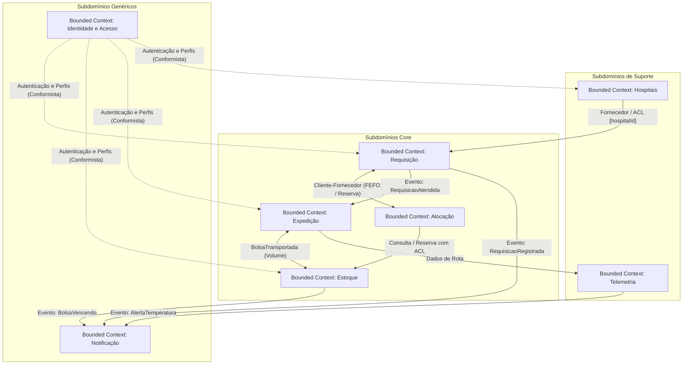
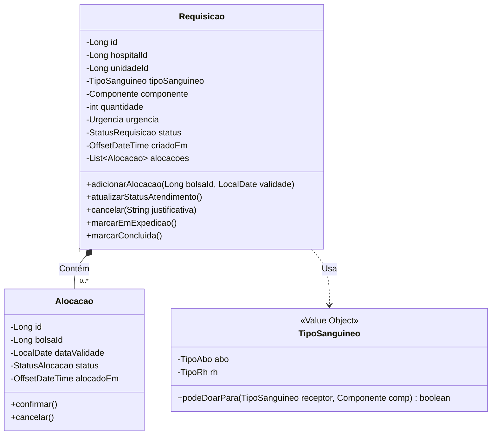
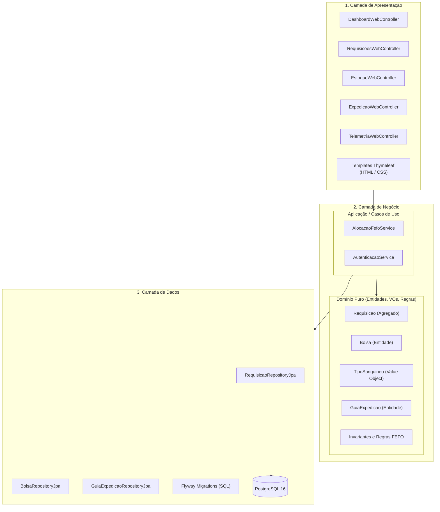
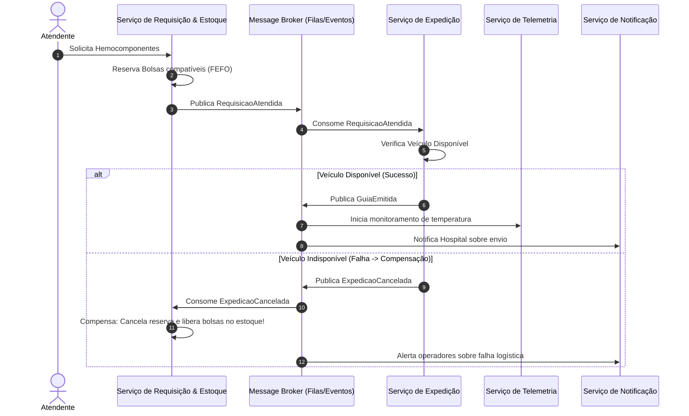
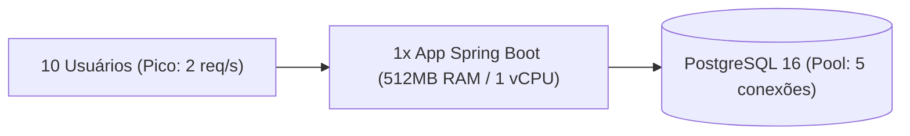
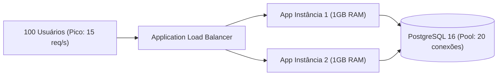
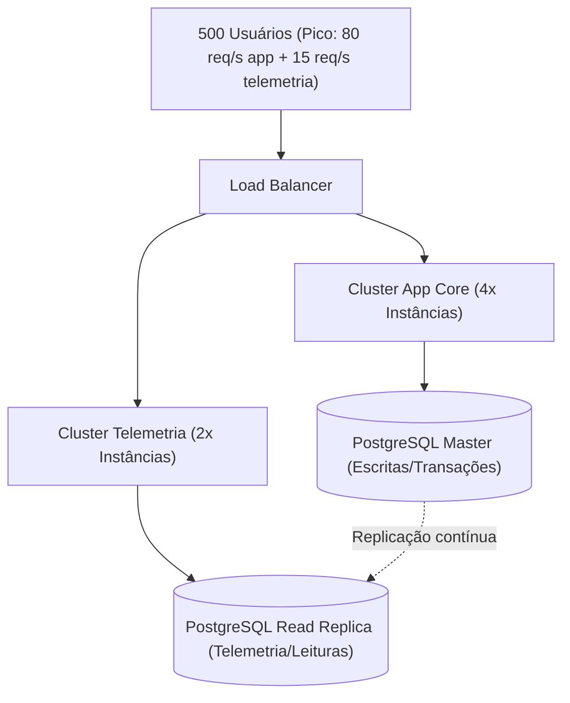

# Diagramas de Arquitetura — Rota Vital

**Projeto:** Rota Vital — Gestão Logística de Hemocomponentes  
**Disciplina:** Infraestrutura de Software · CESAR School · ADS · 2026.2  
**Trabalho:** U2 · Parte 2

Estes diagramas estão em formato Mermaid. Você pode visualizá-los diretamente no GitHub, no VS Code / Antigravity ou exportá-los em imagem / PDF para o relatório final e slides da apresentação.

---

## 1. Mapa de Contextos (Context Map — DDD)

Mostra os 7 Bounded Contexts e seus relacionamentos (Upstream/Downstream, Camada Anticorrupção - ACL, Conformista e Publicador-Assinante).

---

## 2. Modelo Tático do Agregado Principal (Requisição)

Representa a raiz do agregado (`Requisicao`), entidade interna (`Alocacao`) e Objeto de Valor (`TipoSanguineo`).

---

## 3. Arquitetura Lógica em Três Camadas

Destaca a regra de dependência (apenas para baixo, domínio isolado).

---

## 4. Projeção de Microsserviços e Saga Coreografada

Demonstra o fluxo assíncrono com compensação (caso de indisponibilidade de veículo).

---

## 5. Diagramas Físicos de Carga (Cenários 1, 2 e 3)

### Cenário 1 — Carga Baixa (Pequeno porte / 1 instância)

### Cenário 2 — Carga Moderada (20-40 hospitais / 2 instâncias + LB)

### Cenário 3 — Carga Alta (100+ hospitais / Microsserviço de Telemetria + Read Replica)

